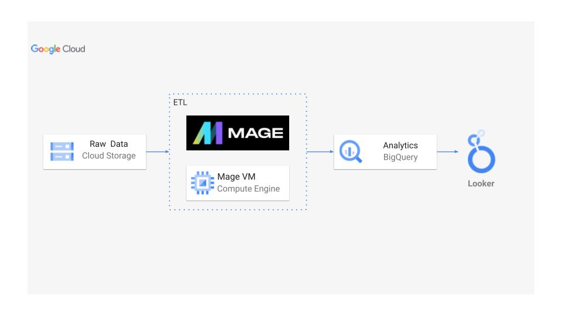
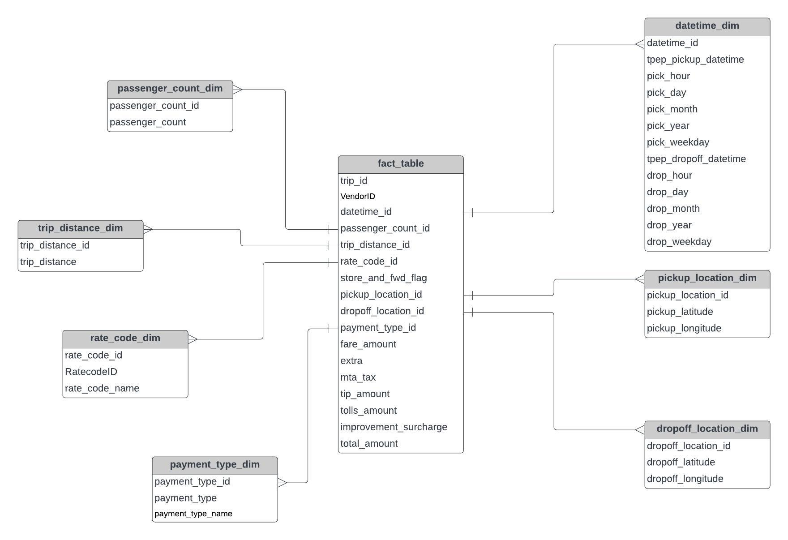

# Análise de Dados da Uber | Projeto Moderno de Engenharia de Dados no GCP

## Introdução
Este projeto explora o mundo da análise de dados da Uber, utilizando práticas modernas de engenharia de dados na Google Cloud Platform (GCP). Vamos recorrer a ferramentas como o Mage.ai para construir um pipeline de ETL, o BigQuery como data warehouse, o Looker Studio para a visualização de dados e o Cloud Storage para gerir os dados ao longo de todo o processo.

## Arquitetura

## Tecnologias Utilizadas
1. Linguagem de Programação - Python
2. Linguagem de Scripting - SQL
3. Google Cloud Platform
   -  BigQuery
   -  Cloud Storage
   -  Looker Studio
   -  Instância de Computação (Compute Instance)
4. Mage.AI (ferramenta moderna de pipelines de dados)

**Ferramenta Moderna de Pipelines de Dados:** https://www.mage.ai/

**Contribua para este projeto aqui:** https://github.com/mage-ai/mage-ai

## Conjunto de Dados Utilizado
TLC Trip Record Data
Os registos de viagens dos táxis amarelos e verdes incluem campos com as datas/horas de recolha e de entrega, os locais de recolha e de entrega, as distâncias das viagens, as tarifas discriminadas, os tipos de tarifa, os métodos de pagamento e o número de passageiros indicado pelo motorista.
Here is the dataset used in the video - https://github.com/darshilparmar/uber-data-engineering-mage-project/blob/main/data/uber_data.csv

### More Info About Dataset
1. Fonte Original dos Dados - https://www.nyc.gov/site/tlc/about/tlc-trip-record-data.page
2. Dicionário de Dados - https://www.nyc.gov/assets/tlc/downloads/pdf/data_dictionary_trip_records_yellow.pdf

## Modelo de Dados

## Scripts do Projeto
1. [Ficheiro Python de Extração](mage-files/extract.py)
2. [Ficheiro Python de Carregamento](mage-files/load.py)
3. [Ficheiro Python de Transformação](mage-files/transform.py)

> **Observação:** Este projeto é uma réplica do projeto original [Uber Data Engineering Mage Project](https://github.com/darshilparmar/uber-data-engineering-mage-project), criado por **Darshil Parmar**. Não sou o autor do projeto original; reproduzi-o apenas para fins de aprendizagem e prática de engenharia de dados, fiz pequenas adaptações, como carregar os dados a partir de um ficheiro local em vez do Google Storage. Todo o crédito pela ideia, estrutura e conteúdo pertence ao autor original. 
## Tutorial Completo em Vídeo
Link do Vídeo - https://www.youtube.com/watch?v=WpQECq5Hx9g
